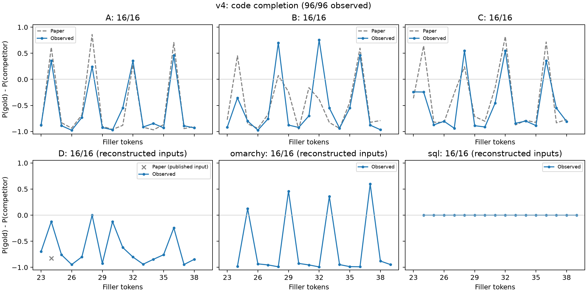
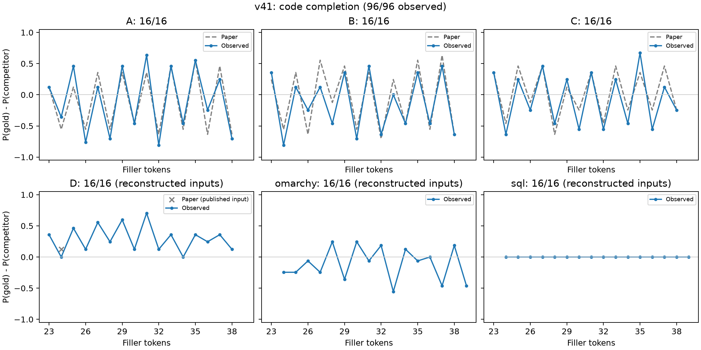

# OpenPWS: Reproducing Periodic Weak Spots

**OpenPWS** is an independent reproduction of the code-completion and 128K key-value retrieval experiments for two post-trained models in [Periodic Weak Spots: Phase Sensitivity from Chunked KV-Cache Compression](https://arxiv.org/abs/2609.36322v1): `DeepSeek-V4-Flash-0731` (V4) and `DeepSeek-V4.1-Flash` (V4.1). Both models use **vLLM** with the original Hugging Face weights. Conversion to the official tensor-parallel checkpoint format is unnecessary.

The goal is to reproduce the published experiments as closely as the available information permits. **Fully specified text follows the paper; unpublished details are explicitly identified as choices made by this project.** This repository does not cover the small-model pretraining, mechanistic analysis, V4 Base/Pro models, or V3.1 control in the paper. The 96 code prompts are variants of a few examples, not a general code-completion benchmark.

## Reproduction fidelity

The reference is **version 1, Appendices B.1–B.3 and C.1, Tables 1–7**. “Matches” below means consistent with the published text and token-coordinate constraints. The complete original input files are unavailable, so byte-for-byte equality with the author inputs cannot be claimed.

| Component | Published details followed here | Uncertain details or choices made by this project | Valid comparison |
|---|---|---|---|
| FP8 A/B/C: 48 prompts | B.2 instruction, non-thinking chat prefix, 974+9 source-token split, fixed sentences, and symbol increments; filler lengths 23–38; target position `1004+L`; token IDs 20199/26/2111 for `FP`/`8`/`32` | No additional prompt wording is needed; the original author token files remain unavailable | Compare A/B/C probability differences and signs by length with Table 2, right, and Table 4, left; account separately for backend differences |
| FP8 D at 24 tokens: 1 prompt | Complete comment sentence in Table 1, with the same B.2 instruction, source, and template | No additional wording is needed for this endpoint | Only this endpoint supports a direct comparison with the corresponding D entry |
| Other FP8 D variants: 15 prompts | Natural-language comments of 23–38 tokens, with similar meaning and no repeated-symbol padding | The other paraphrases are unpublished; `make_extra_prompts.py` generates them using a fixed enumeration rule | Tests the phenomenon under reconstructed prompts; not a pointwise replication of the paper’s D sweep |
| Omarchy: 16 prompts | B.3.1 repository/commit, source file, completion point `setup_scenario docked `, reference `0`, competitor `1`, and natural comments of 24–39 tokens | The paper provides an abbreviated example, not the full prompt or 16 fillers; this project uses the full source prefix and constructs the instruction, comments, and assistant-prefill split | Qualitative supplementary experiment; disagreement with Table 5 does not establish a failed model replication |
| SQL: 16 prompts | B.3.2 test record 2113 (zero-based row 2112), schema/data/SQL, `+`/`-` contrast, both recorded output values and labels, and comments of 24–39 tokens | The published SQL excerpt contains omissions and adjusted line breaks; this project constructs the full wrapper instruction, comment sweep, layout, and prefill split | Qualitative supplementary experiment; Table 6 is not a pointwise prediction reference for these reconstructed prompts |
| V4 128K retrieval: 2,048 prompts | C.1 context length of 128,000 tokens, 16,000 pairs per prompt, four-token records, target at pair 249, eight residue groups, prefill histograms, reversed sentence-pair roles, terminal query, and filler corpus/revision | Seed `260936322`, sampled keys/values/sentences and their assignment order, intro and three examples, and body/tail text are chosen here; filler lengths include the trailing newline; keys and values are sampled independently without replacement | Compare phase effects and their scale under the published protocol; these are not the original author retrieval inputs |
| V4.1 128K retrieval: 20,480 prompts | C.1 uses ten times as many bindings and 2,560 prompts per group, with the same other published constraints | This project repeats the finite histograms in ten complete blocks of 256 bindings as its implementation of scaling the same distribution; the actual author sample is unknown | Same limitation as V4; the two models do not receive identical input sets |
| Weights and backends | Model names match B.2; V4.1 uses vLLM TP8 with expert parallelism, matching the backend category in the paper | Downloads are pinned to revisions here, but the paper does not publish hashes for every weight file; V4 uses vLLM TP8 here and official TileLang TP4 in the paper; kernels, quantization, and parallelism differ | Identical inputs do not imply identical floating-point outputs; backend differences contribute to V4 discrepancies |

Published information is sufficient to determine the construction of **49/96 code prompts**: 48 from A/B/C and the 24-token D endpoint. The other 47 include text constructed by this project. Generated inputs and results retain a `fidelity` field. Paper curves are plotted only for the directly comparable A/B/C variants and the single D endpoint.

**Known mismatch: the SQL token boundary.** The frozen reconstruction retains a space at the completion boundary and scores bare `+`/`-` tokens, while the observed top-1 predictions are space-prefixed ` +`/` -`. The original 0/16 token accuracy therefore does not mean that every predicted operator is wrong. The report preserves that metric and adds a separate spelling diagnostic. These probabilities are not compared directly with Table 6 without the complete author prompts. Revising the boundary requires a new input version and a new run; probabilities for space-prefixed tokens cannot be recovered from the two recorded bare-token probabilities.

The FP8 example uses `inference/kernel.py` from the paper’s footnote and verifies its SHA256 during preparation. The file in the pinned model download is identical to the source at the paper’s revision, `0c18385a15b3b34253d6cf7132f3f4a0442d4ea9`. Fixed hashes for source files, tokenizers, filler text, and generated inputs are listed in [resources.json](resources.json).

Documentation and report labels are in English. Experimental strings and raw model outputs are preserved verbatim, including Unicode delimiters and non-English tokens selected by the tokenizer, because translating them would change the experiment.

### Metrics and controls

- **Code completion:** take `P(gold)` and `P(competitor)` from the full vocabulary distribution and report `Δ=P(gold)-P(competitor)` plus full-vocabulary top-1 accuracy. The two candidate probabilities are not renormalized. Generation uses `temperature=0, max_tokens=1`.
- **Retrieval:** use `temperature=0, max_tokens=8` and exactly `completion.strip().startswith(gold)` as the primary metric. Punctuation after the answer is allowed; a colon before it is not removed. A separate leading-colon diagnostic never replaces the primary metric.
- **Positions:** the source key starts at `63976+prefill_tokens`. Every residue group has mean source position 64,000 and variance 28. The query starts at 127,967 and total length is 128,000. `mod 8` defines reporting groups; the native compression strides are 4 for V4 and 2 for V4.1.
- **Interpretation:** outer padding moves the target and distractor records together, so the comparison does not isolate the target position. Confidence intervals follow the paper’s per-group Wilson 95% intervals; they are not a separate causal analysis.

## Reproduce from a fresh environment

```bash
git clone https://github.com/MuLabPKU/TransArch.git
cd TransArch/OpenPWS
```

Run all commands from the repository root. Requirements are Linux x86_64, Python 3.12, and a CUDA environment compatible with the pinned vLLM/PyTorch versions. GPU experiments also need a working CUDA compilation toolchain because kernels are compiled on first use. The tested configuration is **8× NVIDIA L20Z (SM90, about 79 GiB per GPU), CUDA 13.0, vLLM 0.31.0, PyTorch 2.13.0, and TileLang 0.1.12**. This is the validated configuration; fitting the 128K workload on smaller GPUs has not been verified.

The two models require about 631 GiB of weights, and retrieval arrays plus bindings take about 12 GiB. Allow roughly 1 TB of disk space, including the Python/CUDA environment and download caches, and sufficient host memory. Preparing both retrieval sets retokenizes about 2.88 billion tokens, so CPU preparation also takes time. Current V4 128K inference takes about six seconds per prompt, making a full evaluation several hours long. V4.1 has ten times as many prompts; use the small checks below before a full run.

```bash
# 1. Create an isolated environment and install pinned direct dependencies.
bash setup.sh

# 2. Download pinned models and public data, construct inputs,
#    and independently verify positions, tokenization, and hashes.
#    Without --weights, only the small model resources are downloaded.
bash python.sh prepare.py --model both --stage all --weights

# 3. Run code and retrieval experiments sequentially for both models.
bash run_suite.sh all both

# 4. Rebuild tables and figures from your results and update this README.
bash python.sh report.py --from-results results --plots
```

No original parent project, Qwen project, historical backend, manual checkpoint copy, or private dataset is required. Public resources must be accessible through Hugging Face. Downloads use fixed revisions; mismatched resource hashes cause preparation to fail.

To run one model or one task:

```bash
bash python.sh prepare.py --model v4 --stage code --weights
bash run_suite.sh code v4

bash python.sh prepare.py --model v4 --stage niah
bash run_suite.sh niah v4
# Use prepare.py --offline to reuse resources already downloaded.
# Replace v4 with v41 as needed.
# Stage: all / code / niah. Model: v4 / v41 / both.
```

Both tokenizers/configurations are downloaded even for a V4-only run so that input-token equivalence can be checked. Only the selected models download weights. Set `DEEPSEEK_MODELS` to override the model directory, or set `DEEPSEEK_V4_MODEL` and `DEEPSEEK_V41_MODEL` separately. Suite defaults are `TP=8`, `GPU_MEMORY_UTILIZATION=0.92`, and `MAX_NUM_BATCHED_TOKENS=8192`; the effective token-batch cap for code completion is 2048. Treat changes in environment, hardware, or parameters as a new experiment.

### Resume and smoke tests

Each inference result is appended immediately to `results/*.jsonl`. Restarting the same command skips completed IDs. Changes to the model configuration, weight index, input, or engine settings are rejected when resuming. Preserve earlier results and use an empty output directory for a new configuration. `--limit` is for small checks: partial runs are not marked complete and must not overwrite a complete report.

```bash
bash python.sh score_code.py --model models/DeepSeek-V4-Flash-0731 \
  --output results/smoke_code.jsonl --limit 2
bash python.sh run_niah.py --model models/DeepSeek-V4-Flash-0731 \
  --data prompts/niah_v4 --output results/smoke_niah.jsonl --limit 2
bash python.sh -m unittest discover -p 'test_*.py'
```

`prepare.py` resumes incomplete retrieval construction and verifies completed arrays. The lower-level `make_niah.py --limit 8` option supports preparation smoke tests; only complete datasets that pass `validate_niah.py` may enter inference. Do not modify validated arrays in place.

`VLLM_DEEP_GEMM_WARMUP=skip` is the default to avoid warming many unused shapes at startup. Kernels initialize when actually needed, so first-prompt timing includes initial compilation. Model loading is recorded separately in `.provenance.json`. The warmup setting is also recorded and can be overridden through the environment.

### Rebuild the saved report without a GPU

```bash
# Tables, completeness flags, and metrics: Python standard library only.
# No model download is needed.
python3 report.py

# Rebuild figures and CSV files in a CPU environment.
bash setup.sh cpu
bash python.sh report.py --plots
```

`reports/` contains per-example observations, provenance with local paths removed, metrics, figures, and hashes. `--from-results results` exports your observations into this directory. A complete saved run cannot be silently replaced with partial results. The default `report.py` command rebuilds the saved report without starting GPU inference.

Only a small set of observations from the historical official V4 backend is retained for comparison; its code, logs, and conversion workflow are omitted. Its statistics can be recomputed from those observations, but the vLLM commands above do not rerun that backend. Historical V4.1 observations, if still used, are explicitly labeled beneath the results table.

### Validated reproduction workflow

A fresh directory containing only Git files and a newly created Python environment successfully downloaded the pinned public resources and rebuilt all 96 code prompts, the candidate vocabulary, and the complete 2,048-prompt V4 retrieval set. The final token-array hash matched the evaluation data and independent validation passed. For V4.1, all 2,560 binding sets and 16 complete prompts were checked, including an 8+8 resume; the remaining 20,464 prompts were not rebuilt in that clean-directory check. All seven tests, CPU plotting, and standard-library report regeneration passed. See [reproduction_checks.json](reports/reproduction_checks.json) for the scope. These checks validate input and report reconstruction; GPU completion is reported separately below.

## Repository contents

| Files | Purpose |
|---|---|
| `prepare.py`, `resources.json` | Download pinned public resources, dispatch generators, and verify inputs |
| `make_code_prompts.py`, `make_extra_prompts.py` | Generate the fully specified A/B/C construction and the other code prompts containing reconstructed text, respectively |
| `make_niah.py`, `validate_niah.py` | Construct and independently validate 128K retrieval inputs; `prepare.py` builds the candidate vocabulary |
| `inference.py`, `score_code.py`, `run_niah.py` | Shared vLLM configuration, provenance and resume handling, and the two evaluations |
| `run_suite.sh` | Run tasks sequentially and update the report after each task |
| `report.py`, `plot_results.py` | Compute metrics, plot results, and update this README |
| `sources/` | Small pinned source examples and third-party licenses |
| `reports/` | Report evidence and figures distributed with Git |

`.gitignore` excludes `models/`, `assets/`, `prompts/`, `.venv/`, the local Python runtime, `results/`, `runs/`, caches, and large binaries. Git LFS is not required: weights, the 82 MB filler corpus, and large arrays are recovered by the preparation workflow. Project code uses the [MIT license](LICENSE); third-party attribution and licensing are documented in [THIRD_PARTY_NOTICES.md](THIRD_PARTY_NOTICES.md).

<!-- REPORT:START -->

## Experimental results

These tables are computed from the saved per-example results by `python3 report.py`. Incomplete runs show progress only; missing observations are never replaced with values from the paper.

### Code completion (96 prompts per model)

| Run | Completed | Full-vocabulary top-1 accuracy | Median time per prompt |
|---|---:|---:|---:|
| V4 official backend, TP4 (historical reference) | 96/96 | 18/96 (18.75%) | 3.5855 s |
| V4 vLLM TP8 | 96/96 | 15/96 (15.62%) | 0.2044 s |
| V4.1 vLLM TP8 | 96/96 | 46/96 (47.92%) | 0.1253 s |

The V4.1 entries are from an earlier completed vLLM run. They have not yet been rerun as part of this backend migration; the full reproduction command recomputes them.

| Prompt family | V4 official reference | V4 vLLM | V4.1 vLLM |
|---|---:|---:|---:|
| A | 4/16 (25.00%) | 4/16 (25.00%) | 8/16 (50.00%) |
| B | 4/16 (25.00%) | 3/16 (18.75%) | 8/16 (50.00%) |
| C | 4/16 (25.00%) | 3/16 (18.75%) | 8/16 (50.00%) |
| D | 2/16 (12.50%) | 1/16 (6.25%) | 16/16 (100.00%) |
| omarchy | 4/16 (25.00%) | 4/16 (25.00%) | 6/16 (37.50%) |
| sql | 0/16 (0.00%) | 0/16 (0.00%) | 0/16 (0.00%) |

**SQL token-boundary limitation:** this reconstruction scores bare `+` (ID 13) and `-` (ID 15), whereas the saved predictions use space-prefixed ` +` (ID 940) and ` -` (ID 565). The resulting zero strict token accuracy does not mean that every predicted operator is semantically wrong. The diagnostic below covers these known spellings only; it neither replaces the original metric nor estimates unrecorded probabilities.

| Model | Top-1 is bare `+` or ` +` | Interpretation |
|---|---:|---|
| v4 | 15/16 | Full prompt and token boundary are not aligned with the original author inputs; no quantitative replication claim |
| v41 | 0/16 | Full prompt and token boundary are not aligned with the original author inputs; no quantitative replication claim |

**Direct comparison with the published A/B/C construction (48 prompts)**

| Model | Paper: reference token selected | This run: reference token selected | Matching signs of Δ | Mean absolute difference in Δ |
|---|---:|---:|---:|---:|
| v4 | 11/48 | 10/48 | 45/48 | 0.2201 |
| v41 | 24/48 | 24/48 | 47/48 | 0.1655 |

The paper rounds Δ to three decimal places, which limits the precision of this comparison. Δ=0 is treated as a tie; top-1 accuracy uses the actual generated token. The other D paraphrases and the full Omarchy and SQL prompts are unpublished, so those supplementary experiments are excluded from this per-example agreement calculation. The paper reports a predominantly four-token cycle for V4 and odd/even alternation for V4.1 in A/B/C. The plots below compare the observed probability differences.

The published **D endpoint at L=24**:

| Model | Paper Δ | Observed Δ | Observed top-1 correct |
|---|---:|---:|---|
| v4 | -0.829 | -0.123047 | No |
| v41 | +0.124 | +0.000000 | Yes |

Top-1 agreement between the two V4 backends is 92/96 (95.83%); the ratio of median per-prompt times is 17.54×. The runs use different GPU counts (4 versus 8) and quantized kernels, so this ratio is not an isolated measurement of backend speedup. Per-prompt timing includes on-demand compilation and excludes model loading; see `reports/metrics.json` for the timing statistics.

Prompts with changed top-1 predictions: `fp8_B_24`, `fp8_C_24`, `D_24_reconstructed`, `sql_27_reconstructed`.

The current V4 environment uses SM90 hardware with MARLIN MXFP4 expert kernels, FlashMLA FP8 KV storage, and an FP8 indexer. The historical official backend simulates an FP4 indexer; the MXFP4 indexer in vLLM 0.31.0 requires SM10x hardware. The numerical results differ, and these experiments do not isolate indexer precision as the cause.





### 128K key-value retrieval

The primary metric is exactly `completion.strip().startswith(gold)`. Each binding is tested in eight source-position residue groups, with 256 prompts per group for V4 and 2,560 for V4.1. The gap across groups is reported only after all groups are complete.

| Model | Saved / expected prompts | Status | Strict accuracy on saved prompts only |
|---|---:|---|---:|
| v4 | 450/2,048 | Incomplete; no full retrieval conclusion | 102/450 (22.67%) |
| v41 | 0/20,480 | No observations yet | Not run |

The paper reports retrieval gaps of 19.14 percentage points for V4 and 6.09 for V4.1. Prompt text, random seeds, and sampled records here reconstruct the published protocol, but cannot be assumed identical to the unpublished author inputs. No phase-effect conclusion is drawn from an incomplete run.

<!-- REPORT:END -->
